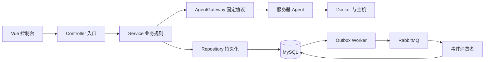

# 01 代码结构与阅读方法

## 一、项目解决什么问题

运维多台服务器时，你原本要逐台 SSH，分别查看容器、日志和资源，操作后还要判断到底是否执行成功。Argus 将“查看”集中在网页，将“执行”做成可追踪的任务。这里真正复杂的是网络失败后的不确定性，不是调用一次 Docker 命令。

目前采集使用控制中心拉取 Agent 的健康和实例快照，不是 Agent 主动向中央上报。每次采集后更新 MySQL，网页通过中央 API 获取资源目录，按中央实例 ID 定位到对应服务器和容器。

## 二、顶层目录怎么读

| 目录 | 做什么 | 为什么单独存在 |
|---|---|---|
| `backend/src/main/java/com/argus/controlcenter` | 控制中心 Java 代码 | 全局业务规则集中管理 |
| `backend/src/main/java/db/migration` | Java Flyway 迁移 | 复杂跨版本字段、外键和索引处理需要程序判断 |
| `backend/src/main/resources/db/migration` | 早期 SQL 迁移 | 简单建表按版本保存，不在启动时随意重建 |
| `backend/src/test` | 后端功能/迁移/可靠性测试 | 证明业务边界，避免仅靠手动点击 |
| `agent/src/main/java/com/argus/agent` | Agent HTTP、采集、命令、Inbox | 限定接触宿主机的权限范围 |
| `frontend/src` | Vue 页面和 TypeScript 状态逻辑 | 将观测、提交中、未知和已接收分开显示 |
| `deploy` | Nginx、systemd、Compose 模板 | 部署方式可复现，真实配置另行注入 |
| `scripts` | 启动、测试与验收入口 | 减少每次手工拼命令造成差异 |
| `docs` | 设计、实现解释、验收与交接 | 设计和实际结果分开记录 |
| `local-private`、`backups` | 私有配置、原始日志、备份 | 已忽略 Git，不将秘密放进源码 |
| `relay` | 独立聊天中转站 | 与 Argus 业务隔离，由其他会话维护 |

## 三、Java 为什么分这么多层

| 包 | 典型类 | 责任 | 不该做什么 |
|---|---|---|---|
| `controller` | `InstanceController`、`NodeController` | 接收 HTTP、校验范围、选择业务入口 | 不直接运行 Docker，不拼持久化流程 |
| `dto` | `ActionRequest`、`CreateNodeRequest` | 接收请求字段与格式校验 | 不作为数据库实体直接保存 |
| `service` | `TaskService`、`TaskQueueStore`、`AgentSnapshotSyncService` | 业务规则、事务、编排 | 不把长时间网络等待包在数据库事务里 |
| `repository` | `TaskRepository`、`InstanceRepository` | 参数化 SQL、结果映射 | 不决定用户是否有权执行动作 |
| `domain` | `Task`、`TaskCommand`、`Node`、`Instance` | 业务对象与状态 | 不把内部凭据返回给浏览器 |
| `vo` | `ApiResponse`、`InstanceLogsVO` | API 返回结构 | 不暴露内部命令绑定和令牌 |
| `infra` | `TaskEventOutboxWorker`、`RabbitTaskEventPublisher` | Redis/MQ 等基础设施实现 | 不替代任务业务事实源 |
| `config` | `TaskControlProperties`、`AgentGatewayProperties` | 配置绑定和保护边界 | 不写入真实密码常量 |
| `identity` | `CurrentActorProvider`、`ProjectAuthorization` | 身份和项目授权骨架 | 不把测试令牌描述成完整注册系统 |
| `exception` | `TaskControlException` | 稳定错误码与异常映射 | 不把任意异常吞成成功空列表 |

`@Service`、`@Repository` 等注解将对象注册到 Spring 容器。类的构造函数声明所需依赖，Spring 创建实例时注入。相比在每个方法里 `new`，这样可以替换测试实现，并集中配置数据源和网关。

## 四、第一次读代码按什么顺序

1. `ArgusControlCenterApplication`：看启动和配置注册。
2. `application.yml` 与 `application-mysql.yml`：看默认环境、开关和私有参数入口。
3. `NodeController.list` → `NodeService.findAll` → `NodeRepository.findAll`：先理解最短查询链。
4. `InstanceController.logs` → `InstanceLogService` → `AgentGatewayService`：理解中央 ID 如何映射到节点和 Agent 局部 ID。
5. `InstanceController.action` → `TaskService.execute` → `TaskQueueStore.enqueue`：理解为什么返回 202。
6. `TaskWorker` → `TaskQueueStore.claim/transition` → `AgentCommandGateway`：理解后台执行与短事务。
7. Agent 的 `TaskService`、`TaskInbox`、`ExecutionRegistry`：理解真正接触 Docker 前后的记录。
8. `TaskReviewStore` 与前端 `TaskResolution.vue`：理解为什么 UNKNOWN 需要独立核对。
9. `infra` 下 Outbox/Publisher/Consumer：理解任务事实如何扩展为通知事件。

## 五、看懂关键命名

| 名称 | 含义 | 常见误解 |
|---|---|---|
| `id` / `taskId` | 中央资源/任务标识 | 不是容器名，也不是浏览器请求键 |
| `agentInstanceId` | 某个节点内的实例标识 | 不同节点可以有相同的 mc01 |
| `nodeId` | 中央登记节点 ID | 不一定等于 Agent 自报 nodeId |
| `agentNodeId` | 固定命令绑定中的 Agent 身份 | 不能只检查 IP 地址而忽略身份 |
| `commandId` | 固定远程命令编号 | HTTP 重试不能生成新编号 |
| `idempotencyKey` | 用户这次操作的请求键 | 不同操作不应重复使用 |
| `storeId` | Inbox 存储身份 | 换新目录不是安全地恢复原执行事实 |
| `version` / `version_no` | 状态版本，更新时比较 | 不是程序版本号 |
| `owner` / `leaseOwner` | 本次 Worker 租约归属 | 不是用户账号 |
| `sampledAt` | Agent 实际采样时间 | 不等于网页刷新时间 |
| `lastCheckedAt` | 中央最后尝试同步时间 | 失败也会推进 |
| `lastSuccessfulSyncAt` | 最近完整清单成功保存时间 | 健康成功但清单失败不能推进 |
| `attempts` | 尝试次数 | 不代表业务执行成功次数 |
| `expected` | 调用前看到并准备核验的目标/状态 | 不等于允许直接覆盖当前事实 |
| `scope` | 项目资源访问范围 | 客户端给出的 projectId 仍需服务端验证 |

## 六、读方法时问自己什么

先找返回值，再找参数来源。然后看它是读操作还是写操作、是否处于事务内、是否调用远端、是否有重复/超时/异常分支。看到 `try/catch` 时确认它是在降级可丢失的缓存，还是错误地吞掉权威数据库失败。看到 `synchronized` 时确认它保护同一对象还是整个服务，会不会把不同节点串行化。

## 七、对应面试追问

- 为什么不用前端直接连 Docker？浏览器不持有 Agent 凭据，中央才能统一授权和审计。
- Controller 和 Service 是不是多余？协议/业务/SQL 分开后，状态机可以脱离 HTTP 测试，事务边界也更清楚。
- 项目用了 ORM 吗？当前主要用 JdbcTemplate；SQL 和锁条件直接可见，不能说成 MyBatis/JPA。
- 这是微服务吗？当前为一个控制中心加多个 Agent，不应仅因有多个进程就描述成完整 Spring Cloud 微服务体系。
- 为什么用 record 也用普通 Java Bean？`TaskCommand` 表达不可变绑定，`Task`/`Node` 支持采集和状态更新；用途不同。
