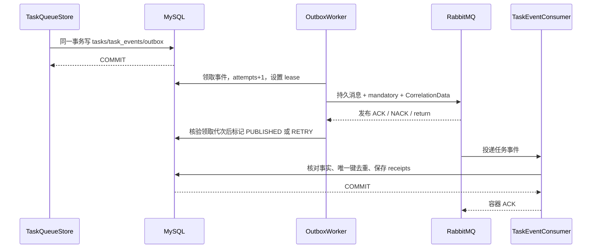

# 03 MQ 队列与可靠消费

## 一、我们究竟用 MQ 做什么

MQ 当前承载任务状态事件的异步通知。真正的 start/stop/restart 执行仍走 MySQL 持久任务队列 → Worker → Agent HTTP → Inbox；RabbitMQ 不直接连接 Docker。

任务状态更新后，将来可能需要告警、统计、通知等订阅者。把这些工作放到原 HTTP 请求里，任何一个下游变慢都会拖慢用户操作。先可靠保存任务事实，再异步发送事件，就能让扩展处理和执行路径解耦。

当前消费者的业务结果是保存“已核对并消费的通知收件记录”。没有接入邮件/短信，不能把收件表描述成已经通知用户。

## 二、从数据库到队列的路径

## 三、拓扑为什么这样设计

代码：`backend/.../infra/MessagingTopology.java`。

| 对象 | 默认名称/值 | 设计意义 |
|---|---|---|
| 主 Exchange | `argus.events`，Topic，durable | 按业务事件类型路由，后续可新增订阅 |
| Routing key | `task.event` | 描述消息类别，不等于队列名 |
| 主消费 Queue | `argus.task-events.consumer.v1`，durable | 保存等待消费者处理的任务事件 |
| Binding | 主 Exchange → 主 Queue，`task.event` | 决定哪些消息能进入此队列 |
| Dead Exchange | `argus.task-events.dead`，Direct，durable | 收集拒绝且不重回主队列的消息 |
| Dead routing key | `failed` | 将死信准确路由到死信队列 |
| Dead Queue | `argus.task-events.dead`，durable | 留待排查和人工处理，不自动无限循环 |

Topic Exchange 支持模式路由，但当前 binding 使用精确 key，没有使用 `#` 订阅全部消息。交换机不储存消息，真正的积压在队列里。多个消费者连同一个队列时竞争分摊消息；如果两个业务都需要完整事件流，应各自建立独立队列并绑定交换机。

主队列换成带版本的新名称，是因为 RabbitMQ 已存在的队列不能直接用不同死信参数重新声明，否则出现 PRECONDITION_FAILED。旧队列如果有存量，发布时需核对并迁移，不能直接删掉。

## 四、相关文件分别写了什么

| 文件/方法 | 实际责任 | 为什么独立 |
|---|---|---|
| `TaskQueueStore.enqueue/transition` | 任务、事件和 Outbox 同事务保存 | 业务事实提交失败时不能发出成功通知 |
| `TaskEventOutboxRepository.append` | 插入待发事件 | 不在原事务内访问网络 |
| `TaskEventOutboxRepository.claim` | 找到到期/租约过期记录并 CAS 领取 | 多 Worker 竞争时只允许一个当前领取者 |
| `TaskEventOutboxRepository.markPublished/markRetry` | 按领取代次回写 | 迟到的旧 Worker 不能覆盖新处理者 |
| `TaskEventOutboxWorker.publishDue` | 定时领取、发送、失败退避 | 与用户请求解耦，重启后可继续扫描 |
| `TaskEventPublisher` | 发布能力接口 | 业务代码不依赖 RabbitTemplate 细节 |
| `RabbitTaskEventPublisher.publish` | 序列化、消息属性、Broker 确认 | 明确区分“方法返回”和“Broker 已接收” |
| `TaskEventConsumer.consume` | 验证、回查任务事实、去重收件 | 下游消息不能成为任务状态的事实源 |
| `V8__task_event_outbox` | Outbox 表与唯一/扫描索引 | 用迁移创建持久待发事实 |
| `V10__task_event_receipts` | 消费收件表 | 消费进程重启后仍能去重 |

## 五、两张表和变量怎么对应

### task_event_outbox

| 字段/代码变量 | 含义 | 使用位置 |
|---|---|---|
| `id` | Outbox 行 UUID | 内部领取和回写，区别于消息 eventId |
| `task_id` / `taskId` | 中央任务 ID | 和 tasks/task_events 关联 |
| `event_sequence` / `sequence` | 此任务的事件序号 | 组成稳定消息 ID；识别重复/顺序 |
| `from_status` / `from` | 转移前状态，可空 | 首次创建没有旧状态 |
| `to_status` / `to` | 这条事件表示的新状态 | 和 task_events 核对 |
| `actor` | 产生事件的角色，如 operator/worker | 审计摘要，不是任意用户凭据 |
| `reason` | 事件原因/结果码 | 便于机器识别和故障排查 |
| `occurred_at` | 业务事件发生时间 | 重试不能把原事件时间改成重试时间 |
| `status` | PENDING/PROCESSING/RETRY/PUBLISHED | Outbox 自己的投递状态，不是任务状态 |
| `attempts` | 领取代次与尝试计数 | 每次领取递增，用于 CAS 防旧写 |
| `next_attempt_at` | 下次允许领取时间 | 失败退避，避免紧循环 |
| `lease_until` / `leaseUntil` | 当前领取有效期 | 崩溃后到期可恢复 |
| `last_error` | 最近失败类别 | 当前仅保存异常类型，避免泄漏敏感连接信息 |
| `published_at` | 收到 Broker 成功确认后的标记时间 | 不等于消费完成时间 |
| `created_at` | Outbox 行创建时间 | 积压年龄/清理依据 |

唯一约束 `(task_id,event_sequence)` 防止业务重复生成同一事件。`idx_outbox_due(status,next_attempt_at,lease_until)` 支撑待发扫描；最终是否高效要用阶段③ EXPLAIN 和实际数据验证，不能因为存在索引就宣称没有慢 SQL。

### task_event_receipts

| 字段 | 含义 |
|---|---|
| `event_id` | 稳定 ID：`taskId:sequence`，主键去重 |
| `task_id` | 事件所属任务 |
| `event_sequence` | 原任务事件序号，另有 `(task_id,event_sequence)` 唯一约束 |
| `event_status` | 此条事件记载的状态 |
| `observed_status` | 消费时回查 tasks 得到的最新权威状态 |
| `consumed_at` | 收件事务保存时间 |

例：先收到 seq=3 的 SUCCEEDED，后收到 seq=1 的 PENDING。两条都可保存；第二条 `event_status=PENDING`，但 `observed_status=SUCCEEDED`。消费者从不把 tasks 改回 PENDING，因此乱序不回退任务状态。

## 六、Outbox 为什么是同事务

错误方案一：先更新任务再发 MQ，数据库成功后进程崩溃，消息永久没发。错误方案二：先发 MQ 再提交数据库，下游可能收到根本没有成功提交的业务状态。

本项目在 `TaskQueueStore` 的短事务里同时写任务、事件和 Outbox；任何一步失败整体回滚。Worker 稍后发送，RabbitMQ 暂时不可用只造成积压，不改变任务事实。网络调用不进入原业务事务，避免持有行锁等待远端。

## 七、发布确认不是一句 convertAndSend

`RabbitTaskEventPublisher` 将 `taskId:sequence` 同时作为 JSON eventId、AMQP messageId 和 CorrelationData ID。`CorrelationData` 关联这一条发送和异步确认。

配置使用 correlated confirm、publisher returns、mandatory，消息设置 PERSISTENT。发送后等待最多 5 秒：

- ACK 且没有 return：可标记 PUBLISHED。
- NACK：Broker 未成功接收，重试。
- return：Exchange 存在但没有匹配队列，重试，不能误判成功。
- 超时：不知道 Broker 是否收到，保留事件重试，可能产生重复消息。
- 线程中断：恢复 interrupt 标志并抛错，不吞掉关闭信号。

durable 是队列/交换机的持久声明，PERSISTENT 是消息投递模式，confirm 是发布确认。三者分别解决不同问题，单独使用一个都不能宣称整个链路绝不丢失。

## 八、领取、租约和代次如何配合

`claim` 先查候选，再用 UPDATE 检查 status、attempts、到期时间；只有 UPDATE 影响一行才得到本次处理权。多个进程可以读到同一候选，但只能一个满足旧 attempts 条件。

旧版只领取 PENDING/RETRY，Worker 在 PROCESSING 崩溃会永远卡住；现在也允许领取已过期的 PROCESSING。每次领取 `attempts+1`，回写必须匹配这个代次。旧 Worker 恢复后即使收到 ACK，也不能把新 Worker 的记录错误标记完成。

Worker 每轮最多处理 20 条，每次只领取 1 条、立即发送，避免先领 20 条后最后一条还没发送就租约过期。默认领取租约 30 秒，单次 confirm 等待 5 秒。外部进程暂停仍可能超出租约，因此下游依旧必须幂等。

失败间隔按 `min(300, 2^min(attempts,9))` 秒退避：2、4、8…256、300。上限是防止无休止增加，并不代表失败任务会自动丢弃。

## 九、消费 ACK、事务和死信

消费者是 Spring Bean，`@RabbitListener` 负责接收，`@Transactional` 包住事实核对和收件写入。方法成功提交后返回，容器才 AUTO ACK。这里 AUTO 表示“容器代替代码发送 ACK”，不等于收到消息立刻确认，也不是没有事务。

消费者线程初始 1 个、最多 2 个，prefetch=10，限制在途消息，避免一次取走大量事件。失败最多尝试 3 次，等待 250ms、500ms，最终 RejectAndDontRequeueRecoverer 拒绝且不重回主队列，Broker 根据 DLX 参数送往死信队列。

唯一约束和业务收件在同一数据库事务；数据库写失败会回滚，不保存半条成功收件。若数据库已提交但 ACK 丢失，Broker 重投时识别已有 eventId 并直接完成，不重复产生业务收件。

经典队列死信转发在 Broker 故障条件下的保证有限；当前没有把它宣传成跨节点无损容灾。生产阶段要验证 Broker 重启、积压、持久卷和死信处理流程。

## 十、故障窗口和预期处理

| 故障窗口 | 现象 | 恢复动作 |
|---|---|---|
| 业务事务回滚 | 没有任务事件/Outbox | 不发送消息 |
| 业务提交后 Worker 未运行 | PENDING 积压 | Worker 重启后扫描 |
| 领取后进程崩溃 | PROCESSING 到期 | 新 Worker 以新 attempts 领取 |
| Broker 收到但 confirm 丢失 | 原事件被重发 | 稳定 eventId，消费者去重 |
| Broker ACK 后数据库回写失败 | Outbox 未完成 | 租约恢复后重发，仍幂等 |
| 消费写库失败 | 没有收件提交 | 有界重试后死信 |
| 消费提交后 ACK 丢失 | 重复投递 | 唯一键防重复收件 |
| 事件乱序 | 收到旧状态事件 | 回查任务最新状态，不修改 tasks |
| 死信积压 | 下游故障/毒消息 | 阶段④监控，排查后受控重放 |

## 十一、测试与证据入口

- `TaskEventOutboxTest`：并发领取、过期恢复、旧回写拒绝、事务回滚、失败退避。
- `RabbitPublisherIntegrationTest`：真实 Broker ACK、持久消息、无路由退回、Outbox 往返。
- `TaskEventConsumerIntegrationTest`：真实监听器、重复、乱序、坏消息、数据库写失败、死信。
- `MySqlMqRecoveryIntegrationTest`：真实 MySQL 迁移及恢复（测试环境显式启用）。
- `RabbitBrokerRestartTest`：prepare/verify 两个进程之间实际重启专用 Broker，验证持久消息。
- 具体结论见 [阶段验收](../MQ可靠性验收-20261019.md)；没有运行到的专项不能算通过。

## 十二、面试官可能怎么追问

1. 为什么不用 MQ 直接执行 Docker？任务执行需要固定目标、互斥、授权和恢复事实，MQ 通知不替代这些规则。
2. 为什么不是 Exactly Once？Broker ACK、数据库提交、Docker 副作用不能组成一个原子事务；当前设计接受重复传输并去重，无法证明副作用时进入 UNKNOWN。
3. 消息顺序怎么保证？当前不依赖全局顺序；序号供识别，消费回查权威状态，不保证队列重试严格顺序。
4. 去重 key 用随机 UUID 可以吗？每次重发都换随机 ID 会失去去重依据；当前消息 ID 由 taskId 和 sequence 稳定构成。
5. 为什么不用 Redis 做消费去重？Redis TTL/丢失不应决定持久业务是否已经完成；当前由唯一键与收件事务保证。
6. MQ 挂了用户任务是不是失败？任务事实已经持久化，事件等待重试；执行任务走原中央队列，不依赖通知是否及时到达。
7. 你怎么证明不是只写了配置？指出真实 Broker 测试、死信接收和 MySQL 恢复日志，再说明生产启用状态。
